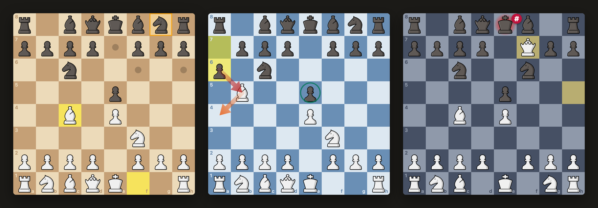
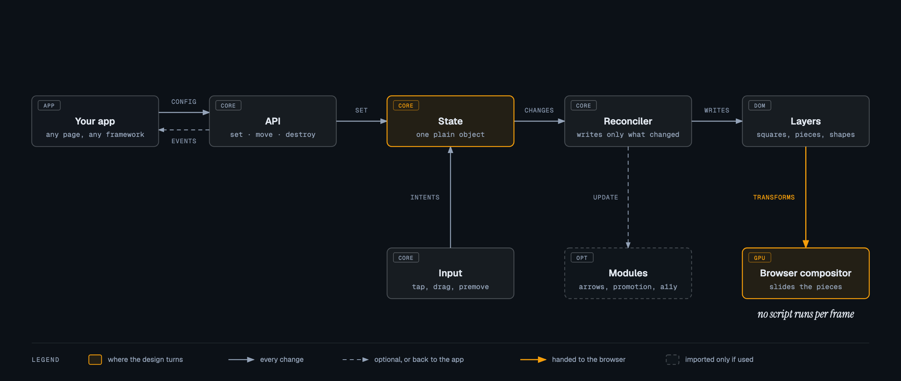

<p align="center"></p>

# Lightsquare

A chessboard for the web that stays smooth on every phone, including old
ones and phones in Low Power Mode.

<p align="center"><a href="https://kibitzo.github.io/lightsquare/"></a></p>

**[Try the demo](https://kibitzo.github.io/lightsquare/)**: play on it,
change its looks, and measure it on your own phone.

- Pieces are moved by the browser, not by script: a move is one style change
  and a CSS transition. A slide keeps going even while the page's script is
  busy (a test shows this in Chromium; real phones are measured with the
  bench page).
- At rest the board does nothing: no timers, no frames, no paints.
- Small: the core is 5.2 kB (minified and gzipped) with no dependencies.
  Arrows, the promotion picker, screen-reader support and the React
  component are separate imports of about 1 kB each.
- The board tells what every change was (a move, a capture, castling, a
  promotion), by the user or by your app, so your sounds, move list or
  clock need no work of their own to find out. The board itself is silent.
- No chess rules inside: your app says which moves are allowed.
- MIT.

## Next to other boards

<!-- comparison: written by compare/run.mjs, do not edit by hand -->
| | Lightsquare | chessground | cm-chessboard | react-chessboard | chessboard.js |
|---|---:|---:|---:|---:|---:|
| Script to download, gzipped | **5.2 kB** | 11.9 kB | 8.1 kB | 21.5 kB | 33.0 kB |
| The same, with arrows, drawing and premove | **7.3 kB** | 11.9 kB | 10.9 kB | 21.5 kB | not offered |
| Elements on the page | **53** | 68 | 154 | 515 | 130 |
| Per move: frames asked of the script | **0** | 25 | 25 | **0** | 26 |
| Per move: writes to the page | **4** | 51 | 162 | 6 | 59 |
| Per move: script time | **0.06 ms** | 2.82 ms | 2.02 ms | 2.77 ms | 4.73 ms |
| Per move: paints | 7.3 | **4.3** | 48.4 | 6.0 | 79.8 |
| Per move: compositing time | 5.28 ms | 16.47 ms | 9.91 ms | **3.61 ms** | 7.08 ms |
| Pictures drawn of a slide while the script is frozen | **51** | 0 | 0 | **51** | 0 |
| Pictures drawn of 12 moves, script busy half the time | **248** | 172 | 169 | 246 | 144 |
| Work to show a position, slowed processor | **0.005 ms** | 0.009 ms | 3.492 ms | 6.238 ms | 0.006 ms |
| Drag: script time | **3.9 ms** | 3.9 ms | 5.0 ms | 36.8 ms | 8.6 ms |
| Drag: style and layout time | 3.6 ms | **1.5 ms** | 4.5 ms | 2.0 ms | 1.6 ms |

Measured 2026-11-12 in headless Chromium on a desktop computer, each
board driven the same way; the best in each row is in bold. Another board
is ahead in: per move: paints; per move: compositing time; drag: style and layout time. The full table, the method and what it
cannot show (it is not a phone) are in
[compare/RESULTS.md](compare/RESULTS.md).
<!-- end of comparison -->

## How a move reaches the screen

<p align="center"><a href="https://kibitzo.github.io/lightsquare/architecture.html"></a></p>

One state, one reconciler, a few writes, and the browser does the sliding.
That last step is the whole point: while a piece moves, no script of the
board runs, so a phone that holds the page's script back cannot make the
slide stutter. The design in full is in [ARCHITECTURE.md](ARCHITECTURE.md);
the rules it obeys, each with a test, are in [RULES.md](RULES.md).

Status: the library draws every board of [Kibitzo](https://kibitzo.com) in
production since November 2026, and is tested in Chromium and WebKit. It is
young: until 1.0 a minor version may change the API.

## Quickstart

**[Run it in the browser](https://kibitzo.github.io/lightsquare/quickstart.html)**:
a playable board in one HTML file with no build step
([the file](docs/quickstart.html); save it and open it).

In a project:

    npm install @kibitzo/lightsquare chess.js

```ts
import { lightsquare } from "@kibitzo/lightsquare";
import "@kibitzo/lightsquare/lightsquare.css";
import "@kibitzo/lightsquare/pieces/kibitzo.css";
import { Chess } from "chess.js";

const chess = new Chess();

// Lightsquare has no chess rules: chess.js answers, the board shows it.
function view() {
  const targets = new Map<string, string[]>();
  for (const { from, to } of chess.moves({ verbose: true })) targets.set(from, [...(targets.get(from) ?? []), to]);
  const turn = chess.turn();
  const king = chess.board().flat().find((piece) => piece?.type === "k" && piece.color === turn);
  return {
    position: chess.fen(),
    targets,
    check: chess.inCheck() ? king!.square : null,
    movable: chess.isGameOver() ? "none" : turn === "w" ? "white" : "black",
  } as const;
}

const board = lightsquare(document.getElementById("board")!, {
  ...view(),
  // The board has already shown the move. Play it in chess.js and answer
  // with the true position.
  onMove({ from, to }) {
    chess.move({ from, to, promotion: "q" });
    board.set(view());
  },
});
```

That is a whole game for two players on one screen: only legal moves, dots
on the squares a piece may go to, the king marked in check. Arrows, a
promotion picker, premove hints and screen-reader support are modules you
add with `board.use(...)`: [docs/API.md](docs/API.md).

The package has two piece sets: Kibitzo (`pieces/kibitzo.css`, above) and
Cburnett (`pieces/cburnett.css`). See Credits for their licences.

What it has: sliding pieces, captures, castling, en passant and promotion
worked out from two positions; tap and drag; premove; last move, check,
selection and move dots; coordinates; your own marks and badges; arrows and
circles, drawn by the app or by the user; a promotion picker; HTML on
squares; screen-reader text and moves by keyboard; a React component;
themes as data (squares, pieces, arrows) that one call applies to a whole
page.

## Read first

- [docs/API.md](docs/API.md): everything the library offers.
- `npm run bench`: the playground. Play, change the looks, measure on a
  phone. `npm run demo` builds the same page as plain files (`site/`); it
  is published at https://kibitzo.github.io/lightsquare/ on every push.
- [compare/RESULTS.md](compare/RESULTS.md): the full comparison with four
  other boards (Lichess's chessground, cm-chessboard, react-chessboard and
  chessboard.js), with the method and its limits. The comparison is a
  project of its own in `compare/`; the library does not depend on it.
- [RULES.md](RULES.md): the hard rules every change obeys.
- [docs/RELEASING.md](docs/RELEASING.md): how a version reaches npm.
- [ARCHITECTURE.md](ARCHITECTURE.md): the design, the comparison with other
  boards, how it is tested, the order of work.

## Work on it

    npm test                 unit tests
    npm run test:browser     Chromium and WebKit, desktop and phone profiles
    npm run build            dist/ and the sizes
    npm run check:package    the packed npm file, met as a user meets it
    npm run bench            a page for a real phone, on the local network

## Credits

The Kibitzo chess pieces are our own, drawn for [Kibitzo](https://kibitzo.com)
and this board: © 2026 Danubian Research AG, CC BY 4.0. Use them, also in a
commercial product, and give credit ("Kibitzo chess pieces, kibitzo.com"):
[piece-sets/NOTICE.md](piece-sets/NOTICE.md).

The Cburnett chess pieces are by Colin M.L. Burnett, from Wikimedia Commons,
used under the BSD licence: [assets/cburnett/NOTICE.md](assets/cburnett/NOTICE.md).
